<a href="https://20akshay00.github.io/">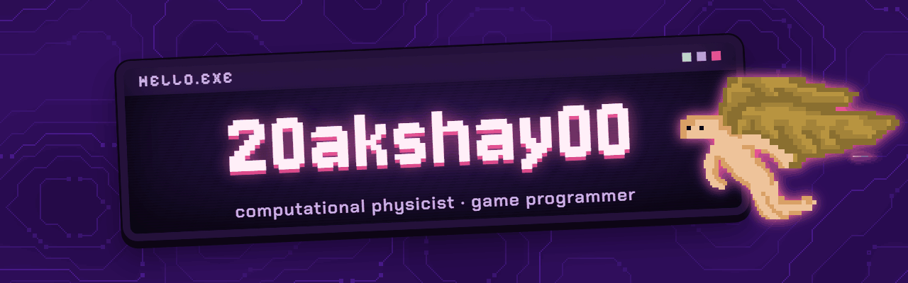</a>

  <a href="https://20akshay00.github.io/"><b>website</b></a> ·
  <a href="https://20akshay00.itch.io/"><b>itch.io</b></a> ·
  <a href="https://scholar.google.com/citations?user=8XmbbYgAAAAJ"><b>publications</b></a> ·
  <a href="https://www.linkedin.com/in/20akshay00"><b>linkedin</b></a>

I'm Akshay, a PhD student at **Ghent University** developing tensor networks methods for studying **one-dimensional quantum gases in the continuum**.
When I'm not doing physics, I also enjoy making simple arcade games using **Godot**.

  <picture>
    <source media="(prefers-color-scheme: dark)" srcset="https://skillicons.dev/icons?i=julia%2Cpy%2Ccpp%2Cjs%2Cgodot%2Cgit%2Clinux%2Cblender&theme=dark">
    
  </picture>

## `~/research`

The software behind my research, all in Julia.

<a href="https://github.com/20akshay00/TentMPS.jl">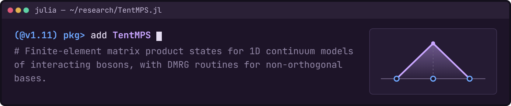 add TentMPS: finite-element matrix product states for 1D continuum models of interacting bosons, with DMRG routines for non-orthogonal bases."></a>
<a href="https://github.com/20akshay00/LiebLinigerBetheAnsatz.jl">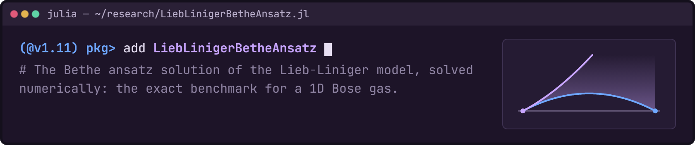 add LiebLinigerBetheAnsatz: the Bethe ansatz solution of the Lieb-Liniger model, solved numerically."></a>
<a href="https://github.com/20akshay00/HermiteUtils.jl">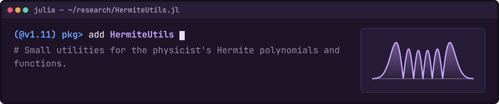 add HermiteUtils: small utilities for the physicist's Hermite polynomials and functions."></a>

## `~/games`

Jam games made as part of a team. They're all playable on [itch.io](https://20akshay00.itch.io/), and the
source can be found in [this list](https://github.com/stars/20akshay00/lists/mygames).

<table>
  <tr>
    <td align="center" width="33%"><a href="https://20akshay00.itch.io/notdeadyet">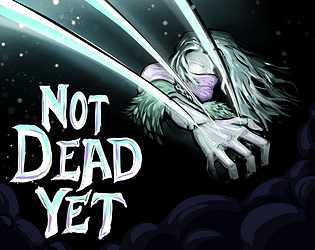</a> <b>Not Dead Yet</b> · GMTK 2026</td>
    <td align="center" width="33%"><a href="https://20akshay00.itch.io/repressed">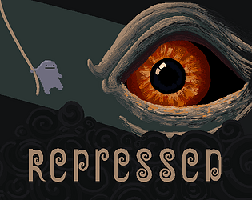</a> <b>Repressed</b> · Brackeys 2026.1</td>
    <td align="center" width="33%"><a href="https://20akshay00.itch.io/cyberloop">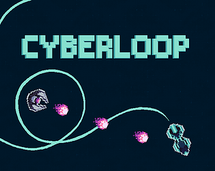</a> <b>Cyberloop</b> · GMTK 2025</td>
  </tr>
  <tr>
    <td align="center"><a href="https://20akshay00.itch.io/v1rusexe">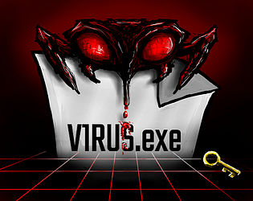</a> <b>V1RUS.exe</b> · Beginner's Jam 2024</td>
    <td align="center"><a href="https://20akshay00.itch.io/sketchometry">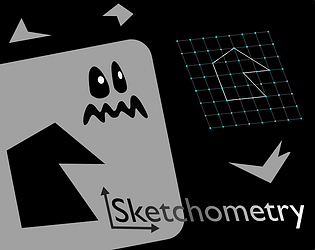</a> <b>Sketchometry</b> · GMTK 2024</td>
    <td align="center"><a href="https://quantum-forge-games.itch.io/lest-ye-falter">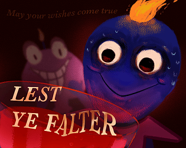</a> <b>Lest Ye Falter</b> · Secret Cult Horror Jam</td>
  </tr>
  <tr>
    <td align="center"><a href="https://quantum-forge-games.itch.io/cellular-conquest">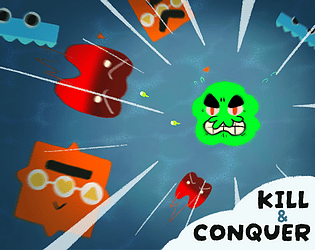</a> <b>Cellular Conquest</b> · Godot Jam 2024</td>
    <td align="center"><a href="https://roman-hyacinths.itch.io/summon-squad">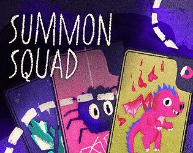</a> <b>Summon Squad</b> · Ludum Dare 55</td>
    <td align="center"><a href="https://20akshay00.itch.io/trickshot">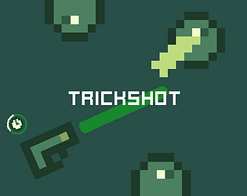</a> <b>Trickshot</b> · GMTK 2023</td>
  </tr>
</table>

## `~/misc`

<table>
  <tr>
    <td width="33%" valign="top"><a href="https://github.com/20akshay00/godot-wii-input/">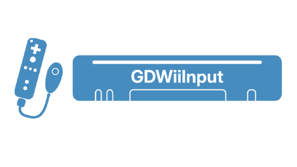</a> <b><a href="https://github.com/20akshay00/godot-wii-input/">GDWiiInput</a></b> A GDExtension that lets Godot games read Wii remotes.</td>
    <td width="33%" valign="top"><a href="https://github.com/OpenPsiMu/ThePhysicsHub">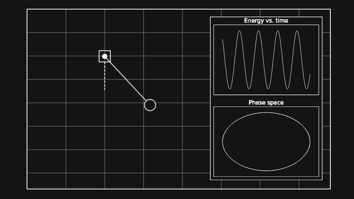</a> <b><a href="https://github.com/OpenPsiMu/ThePhysicsHub">ThePhysicsHub</a></b> Interactive physics simulations in p5.js, built by a group of undergraduates.</td>
    <td width="33%" valign="top"><a href="https://github.com/DhruvaSambrani/turing-hunt-engine">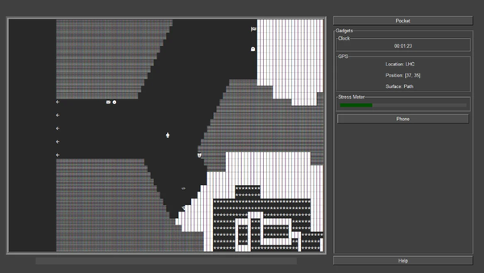</a> <b><a href="https://github.com/DhruvaSambrani/turing-hunt-engine">Tetra</a></b> A small 2D game engine in Python that renders in ASCII.</td>
  </tr>
</table>
